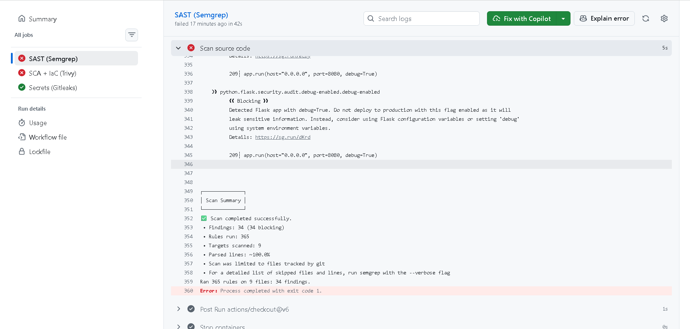
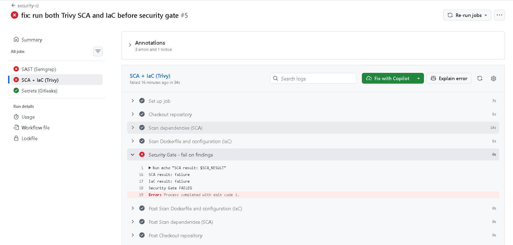
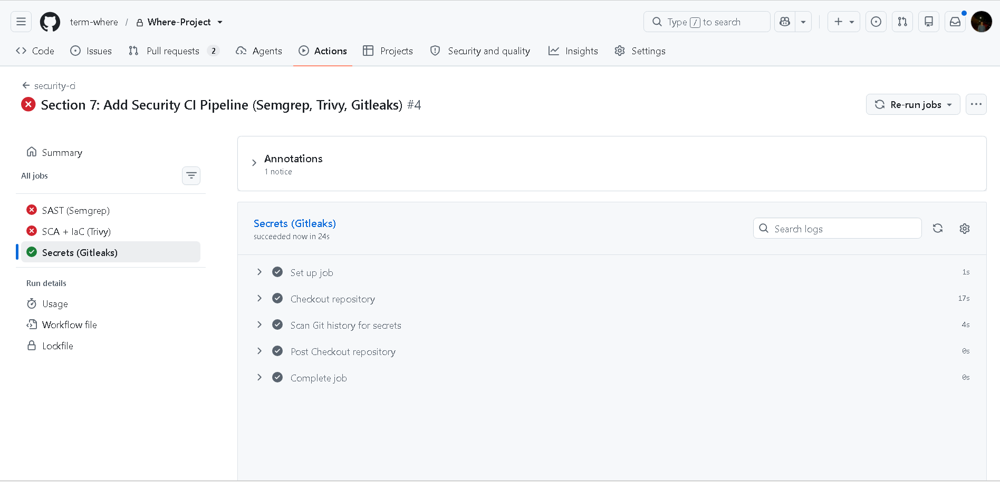
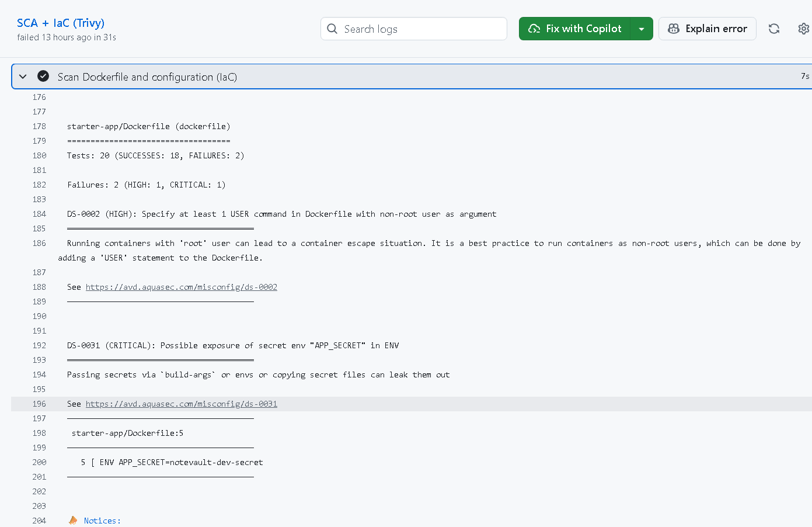

# Term Project Report — Secure Build

> Fill in every section. Keep the headings. Total **100 pts** (see rubric at the end).
> This is **team work** (2–3). Do not share your report with other teams.

## Cover

| Field | Value |
|---|---|
| Team name | |
| Members (name + ID) | |
| Target application | |
| Repository URL | |
| Date | |

## AI-tool usage disclosure
*Academic integrity: state how you used any AI tools (ChatGPT, Copilot, etc.) — e.g. searching, coding, translating, drafting. "None" is a valid answer.*

| Tool | How it was used |
|---|---|
| | |

---

## 1. Executive Summary
*(½ page) What the app is, how many findings by severity, and the overall risk before vs. after your fixes.*

---

## 2. System Scope & Function
- What the application does; in-scope components and endpoints.
- **Data-Flow Diagram (DFD):** processes, data stores, external entities, **trust boundaries** (insert image).

---

## 3. Threat Model — STRIDE  *(20 pts)*

| Element / data flow | S | T | R | I | D | E | Top threat & mitigation |
|---|---|---|---|---|---|---|---|
| | | | | | | | |

*Then rank the top 5 risks by likelihood × impact.*

---

## 4. Vulnerability Findings  *(25 pts)*

One block per finding (copy as needed):

### Finding F-01 — Unsalted MD5 Password Storage

| Field | Value |
|---|--|
| CWE | CWE-916 / CWE-327 |
| OWASP 2025 | A04 — Cryptographic Failures |
[Hashcat cracked NoteVault MD5 hashes](img/week03-task5-hashcat-cracked.png)
| Severity | High |
| Location | `project/starter-app/app.py` — password hashing / seed data |
| Reproduction | 1. Obtain the MD5 hashes from the NoteVault seed data. 2. Run Hashcat with mode `-m 0`. 3. Use a small username-based candidate list with suffix rules. 4. Hashcat recovers `alicepw` and `admin123`. |
| Impact | An attacker who obtains the password database can perform fast offline guessing and recover weak passwords. |
| Evidence | Hashcat recovered `alicepw` and `admin123` from the project hashes; attach the screenshot showing `Recovered: 2/2 (100.00%)`. |
|Mitigation:| Replace unsalted MD5 with Argon2id or bcrypt using a unique salt for each password. Rehash legacy MD5 records after a successful login.|
---

## 5. Remediation  *(25 pts)*

Per finding: the fix, **before/after** code, and the commit that implements it.

### Fix for F-01
```diff
- vulnerable line
+ fixed line
```
- **Why this fixes it:** …
- **Commit:** `<hash>`
- **Proof the exploit now fails:** (screenshot)

---

## 6. Supply-Chain Hardening  *(15 pts)*
- **SBOM** (CycloneDX) generated — attach `sbom.json`, note component count.
- **Artifact signed & verified** with Cosign — paste the `cosign verify` output.
- One-paragraph **SLSA** self-assessment (which level, why).

---

## 7. Security CI Pipeline *(10 pts)*

### 7.1 GitHub Actions Security Pipeline

An automated security CI pipeline was implemented for the NoteVault application using GitHub Actions. The workflow integrates Semgrep, Trivy, and Gitleaks to identify security vulnerabilities, insecure configurations, and exposed secrets.

**Repository:** [Where-Project](https://github.com/term-where/Where-Project)

**Workflow:** `.github/workflows/security-ci.yml`

**Pull Request:** [Section 7 — Security CI Pipeline](https://github.com/term-where/Where-Project/pull/2)

### 7.2 Security Scanning Results

| Security Tool | Purpose | Result |
|---|---|---|
| Semgrep (SAST) | Static application security testing | FAIL — 34 blocking findings |
| Trivy (SCA) | Dependency vulnerability scanning | FAIL — Dependency vulnerabilities detected |
| Trivy (IaC) | Dockerfile configuration scanning | FAIL — 2 misconfigurations |
| Gitleaks | Git history secret scanning | PASS — Scan completed successfully |
| Security Gate | Enforce security policy | FAIL — Exit Code 1 |

**Semgrep Findings**

Semgrep detected 34 blocking security findings in the application. One confirmed example was the use of `debug=True` in Flask, which can expose sensitive debugging information.



**Trivy Security Gate**

Trivy completed both SCA and IaC scans. The security gate detected unsuccessful scan outcomes and exited with code 1.

```text
SCA result: failure
IaC result: failure
Security Gate FAILED
Process completed with exit code 1.
```



**Gitleaks Secret Scanning**

Gitleaks successfully scanned the Git repository using its Docker CLI. The job passed without a reported secret finding.



### 7.3 Trivy IaC Findings

Trivy identified two Dockerfile misconfigurations:

| Rule ID | Severity | Description |
|---|---|---|
| DS-0002 | HIGH | Container does not explicitly use a non-root user |
| DS-0031 | CRITICAL | Potential exposure of `APP_SECRET` through a Dockerfile environment variable |

**Scan Summary:**

- Total checks: 20
- Successful checks: 18
- Failed checks: 2
- HIGH findings: 1
- CRITICAL findings: 1

These findings demonstrate that insecure container configurations can be detected automatically before changes are merged into the main branch.



### 7.4 Security Gate Configuration

The GitHub Actions pipeline enforces security checks through command exit codes.

- **Semgrep:** Uses `--error` to fail when blocking security findings are detected.
- **Trivy SCA:** Uses `exit-code: '1'` for HIGH/CRITICAL dependency vulnerabilities.
- **Trivy IaC:** Uses `exit-code: '1'` for HIGH/CRITICAL configuration findings.
- **Gitleaks:** Uses `--exit-code 1` to fail when potential secrets are detected.

The Trivy scanning steps use `continue-on-error: true` so that both SCA and IaC checks can execute even when the first scan detects vulnerabilities.

A final security gate evaluates the original scan outcomes using `steps.sca.outcome` and `steps.iac.outcome`. If either result is unsuccessful, the job exits with code 1.

This configuration prevents a failed scan from silently passing the security gate while allowing multiple security reports to be generated in a single workflow run.

### 7.5 Conclusion and Next Steps

The security pipeline successfully demonstrated automated detection and build failure enforcement. Semgrep identified insecure application code, Trivy detected dependency vulnerabilities and Dockerfile misconfigurations, and Gitleaks completed secret scanning successfully.

The pipeline currently fails because the starter application contains known security findings. After the team completes remediation, the workflow must be executed again to validate that the identified vulnerabilities have been addressed.

The final goal is to achieve successful security checks without disabling security rules or bypassing the configured gates.

## 8. Conclusion & Reflection  *(5 pts — clarity)*
- Residual risks and what you'd harden next.
- Lessons learned.

---

## Appendix
- Tools used, references (OWASP/CWE links), and the team's task split.

---

## Grading rubric (100)

| Criterion | Pts |
|---|---|
| Threat model quality & completeness (§3) | 20 |
| Vulnerability findings — correctness, CWE/OWASP mapping, depth (§4) | 25 |
| Remediation quality — correct, minimal, well-explained (§5) | 25 |
| Supply-chain hardening — SBOM + signing + provenance (§6) | 15 |
| CI pipeline — works, fails build appropriately (§7) | 10 |
| Presentation & report clarity (§1, §8) | 5 |

*All work stays within the [ethics policy](../ETHICS.md).*
