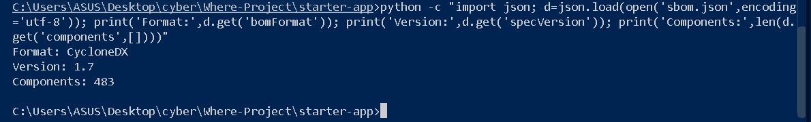
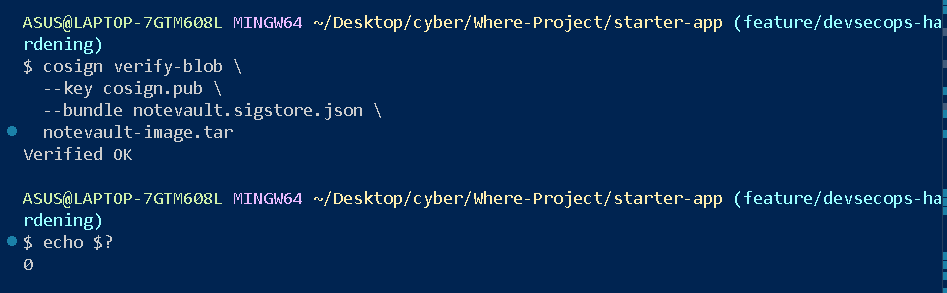

# Term Project Report — Secure Build

> Fill in every section. Keep the headings. Total **100 pts** (see rubric at the end).
> This is **team work** (2–3). Do not share your report with other teams.

## Cover

| Field | Value |
|---|---|
| Team name | |
| Members (name + ID) | |
| Target application | |
| Repository URL | |
| Date | |

## AI-tool usage disclosure
*Academic integrity: state how you used any AI tools (ChatGPT, Copilot, etc.) — e.g. searching, coding, translating, drafting. "None" is a valid answer.*

| Tool | How it was used |
|---|---|
| | |

---

## 1. Executive Summary
*(½ page) What the app is, how many findings by severity, and the overall risk before vs. after your fixes.*

---

## 2. System Scope & Function
- What the application does; in-scope components and endpoints.
- **Data-Flow Diagram (DFD):** processes, data stores, external entities, **trust boundaries** (insert image).

---

## 3. Threat Model — STRIDE  *(20 pts)*

| Element / data flow | S | T | R | I | D | E | Top threat & mitigation |
|---|---|---|---|---|---|---|---|
| | | | | | | | |

*Then rank the top 5 risks by likelihood × impact.*

---

## 4. Vulnerability Findings  *(25 pts)*

One block per finding (copy as needed):

### Finding F-01 — Unsalted MD5 Password Storage

| Field | Value |
|---|--|
| CWE | CWE-916 / CWE-327 |
| OWASP 2025 | A04 — Cryptographic Failures |
[Hashcat cracked NoteVault MD5 hashes](img/week03-task5-hashcat-cracked.png)
| Severity | High |
| Location | `project/starter-app/app.py` — password hashing / seed data |
| Reproduction | 1. Obtain the MD5 hashes from the NoteVault seed data. 2. Run Hashcat with mode `-m 0`. 3. Use a small username-based candidate list with suffix rules. 4. Hashcat recovers `alicepw` and `admin123`. |
| Impact | An attacker who obtains the password database can perform fast offline guessing and recover weak passwords. |
| Evidence | Hashcat recovered `alicepw` and `admin123` from the project hashes; attach the screenshot showing `Recovered: 2/2 (100.00%)`. |
|Mitigation:| Replace unsalted MD5 with Argon2id or bcrypt using a unique salt for each password. Rehash legacy MD5 records after a successful login.|
---

## 5. Remediation  *(25 pts)*

Per finding: the fix, **before/after** code, and the commit that implements it.

### Fix for F-01
```diff
- vulnerable line
+ fixed line
```
- **Why this fixes it:** …
- **Commit:** `<hash>`
- **Proof the exploit now fails:** (screenshot)

---

## 6. Supply-Chain Hardening *(15 pts)*

### 6.1 Software Bill of Materials (SBOM)

A Software Bill of Materials (SBOM) was generated for the NoteVault Docker image using Trivy. The SBOM follows the CycloneDX 1.7 specification and contains **483 components**, including operating system packages and application dependencies.

- **Tool:** Trivy v0.74.0
- **Target Image:** `starter-app-notevault:latest`
- **Format:** CycloneDX 1.7
- **Output:** `starter-app/sbom.json`
- **Total Components:** 483

**Command:**

```bash
docker run --rm \
  -v /var/run/docker.sock:/var/run/docker.sock \
  -v "$PWD:/output" \
  aquasec/trivy:latest image \
  --format cyclonedx \
  --output /output/sbom.json \
  starter-app-notevault:latest
```

**Verification Result:**

```text
Format: CycloneDX
Version: 1.7
Components: 483
```
**Evidence — SBOM Verification**


The generated SBOM provides visibility into the dependencies included in the Docker image. This information supports dependency management, vulnerability tracking, and software supply-chain risk assessment.

**Evidence:** `starter-app/sbom.json` and a screenshot showing the SBOM verification results.

### 6.2 Artifact Signing and Verification with Cosign

The NoteVault Docker image was exported as a TAR archive and digitally signed using Cosign v3.1.4. The signature was verified using the corresponding public key to confirm that the artifact had not been modified after signing.

**Step 1 — Export Docker Image**

```bash
docker save -o notevault-image.tar starter-app-notevault:latest
```

**Step 2 — Sign Artifact**

```bash
cosign sign-blob \
  --key cosign.key \
  --bundle notevault.sigstore.json \
  notevault-image.tar
```

**Step 3 — Verify Signature**

```bash
cosign verify-blob \
  --key cosign.pub \
  --bundle notevault.sigstore.json \
  notevault-image.tar
```

**Verification Result:**

```text
Verified OK
Exit Code: 0
```


The successful verification confirms the integrity and authenticity of the archive relative to the signing key used. The private key (`cosign.key`) is excluded from Git to prevent unauthorized use.

**Evidence:**
- `starter-app/cosign.pub` — Public verification key
- `starter-app/notevault.sigstore.json` — Signature bundle
- Screenshot showing `Verified OK` and exit code 0

**Limitation:** This implementation signs an exported Docker image archive using `cosign sign-blob`. It does not yet sign a container image digest stored in a registry. Registry-based image signing should be implemented for the final release if required by the project's release process.

### 6.3 SLSA Self-Assessment

The current NoteVault project uses a local Docker build process and manually signs the exported image archive. Although we have generated an SBOM and verified its digital signature, the build process does not yet generate trusted, verifiable provenance.

Therefore, the project does not currently claim SLSA Build Level 1 or higher.

To improve software supply-chain security, the team plans to automate image builds through GitHub Actions, generate provenance attestations, pin dependencies and GitHub Actions to immutable references, and sign the final release artifact.

This would improve build traceability, integrity verification, and protection against software supply-chain attacks.

### 6.4 Final Release Considerations

The current SBOM and signature were generated from the starter application image before all security remediations were completed.

After the development team finishes fixing the identified vulnerabilities, the final Docker image must be rebuilt. A new CycloneDX SBOM must then be generated, and the final artifact must be signed and verified again.

This ensures that the submitted supply-chain evidence corresponds to the actual remediated release.
**Generated Artifacts:**

- [CycloneDX SBOM](starter-app/sbom.json)
- [Cosign Public Key](starter-app/cosign.pub)
- [Cosign Signature Bundle](starter-app/notevault.sigstore.json)


## 7. Security CI Pipeline  *(10 pts)*
- Link to the GitHub Actions workflow (SAST + SCA + secret scanning).
- Screenshot of a build **failing** on a HIGH/CRITICAL finding.
- How the gate is configured (what fails the build).

---

## 8. Conclusion & Reflection  *(5 pts — clarity)*
- Residual risks and what you'd harden next.
- Lessons learned.

---

## Appendix
- Tools used, references (OWASP/CWE links), and the team's task split.

---

## Grading rubric (100)

| Criterion | Pts |
|---|---|
| Threat model quality & completeness (§3) | 20 |
| Vulnerability findings — correctness, CWE/OWASP mapping, depth (§4) | 25 |
| Remediation quality — correct, minimal, well-explained (§5) | 25 |
| Supply-chain hardening — SBOM + signing + provenance (§6) | 15 |
| CI pipeline — works, fails build appropriately (§7) | 10 |
| Presentation & report clarity (§1, §8) | 5 |

*All work stays within the [ethics policy](../ETHICS.md).*
